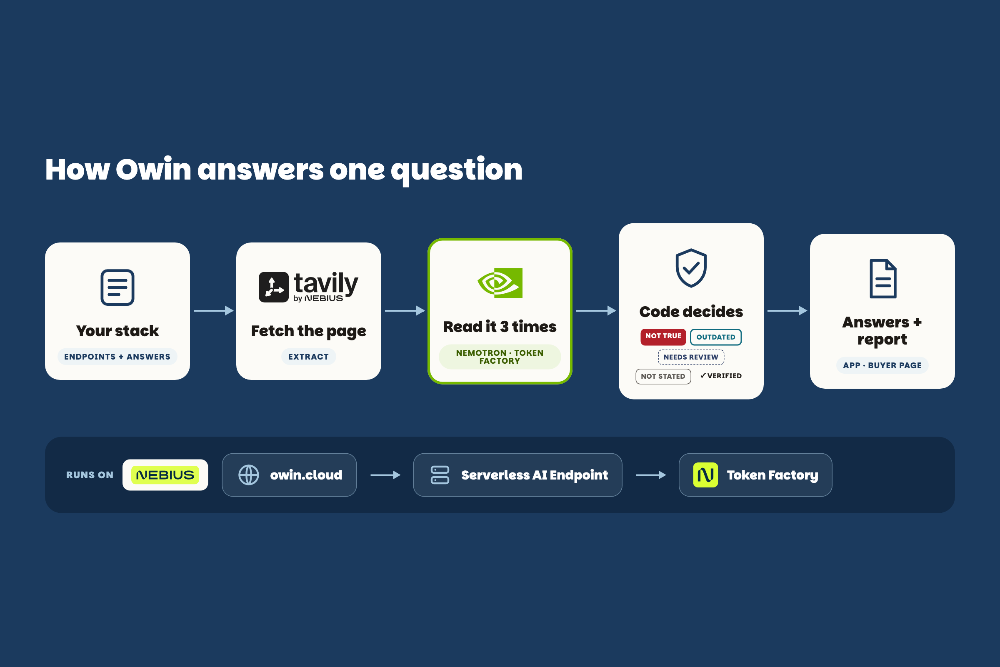

<p>
  <picture>
    <source media="(prefers-color-scheme: dark)" srcset="owin/web/img/logo-dark.svg">
    
  </picture>
</p>

# Owin

**On 7 AI vendors (6 of them new to Owin; pre-registered split `v3fresh`: 11 features on 8 pages), Owin filled 27 of 33 security-review answers on its own and got 26 right, 18 with the vendor's sentence and 8 correctly "not stated"; the other 6 it handed to a person to review, and on those a majority vote would have been right only 2 times. A plain majority vote over all 33 gets 28; it is wrong on 4 of the 6 Owin hands to a person.** The one confident miss is a label error we found ourselves and kept as pre-registered ([below](#what-well-tell-you-before-you-find-it)). Recompute it with no key: `owin eval selective --corpus datause --split v3fresh`. Every number here is in [FACTS.md](FACTS.md), and a test recomputes each one.

[](.github/workflows/proof.yml) 

## What it is

A buyer's security review asks what each AI vendor does with your data: training, retention, zero data retention (ZDR), region, access. The honest answer is per feature, not per vendor: Anthropic's Messages API can run under ZDR, but "The MCP connector is not covered by ZDR arrangements." Owin reads each vendor's own page for the features your endpoints call, fills the answers with the supporting sentence, and marks each one Not true, Outdated, Needs review, Not stated or Verified, so you can send the buyer a report with a source behind every answer.

## Try it

- **https://owin.cloud/judge**: the start page, with the number recomputed on load and three guided paths.
- **https://owin.cloud/app**: the answer screen for a fictional company, Lumen Notes.
- **https://owin.cloud/trust**: the read-only buyer page.

<!-- LIVE_URL --> Locally, with no key, network or login:

```bash
poetry install && poetry run owin serve   # then open http://127.0.0.1:8787/judge
```

`docker build -t owin . && docker run -p 8080:8080 owin` serves the same app; hosting on a Nebius Serverless AI Endpoint is in [DEPLOY.md](DEPLOY.md).

## Architecture



Nemotron reads each page three times. A cell is answered automatically only when the readings agree and each value has a verbatim sentence from the page; anything else goes to a person as Needs review. Plain code, not model prose, sets every status.

## Sponsor technology

| Sponsor | Technology | What it does in Owin |
|---|---|---|
| Nebius | Token Factory | Hosts every model call: $0.0029 per reading (39 calls, $0.115 total, list price $0.30 / $0.90 per M tokens), mean 8.8 s, p95 15.9 s; about **$0.009** per endpoint (three readings). |
| NVIDIA | Nemotron 3 Super (`nvidia/nemotron-3-super-120b-a12b`, open-weight) | The reader: three readings per page into five fields, each with a verbatim quote. Reasoning stays on: with it off, Owin gets only 21 of 28 right (`eval/thinking-off-vs-on.json`). |
| NVIDIA | Nemotron 3 Ultra | Alone, it answers 30 of 33 cells on its own and gets 29 right. Owin uses it only where Super's readings split, under a rule written before Ultra ran: 4 of those 6 cells were answered automatically and right, at $0.035 more per such page; 2 still go to a person. Overall: 31 of 33 answered, 30 right (`owin eval ladder --corpus datause --brief`). |
| Nebius | AI Cloud: Serverless AI Endpoint | Runs the whole app as one container (`cpu-d3`, 2 vCPU, 8 GB) ([DEPLOY.md](DEPLOY.md)). |
| Nebius | AI Cloud: Compute VM | The owin.cloud front door: HTTPS in front of the endpoint. |
| Tavily | Extract | Fetches each vendor page whole and records the time, hash and "Last updated" date, so Outdated is a dated observation. An older copy than one already trusted is set aside. `owin sweep` covers 29 vendors. |

## The evaluation

On `v3fresh`: answered automatically **27/33**, right among those **26/27**, 6 to a person (a majority vote would have been right on 2/6); a plain majority vote gets 28/33. Negative controls: 6/6 cells correctly "not stated".

The labels for `v3fresh` were committed (`42b8994`) before prompt v3 was written and frozen (`8205f8d`); nothing was edited after scoring. The pre-registered whole-item score is **7/11, which fails our own 80% bar** (keyword baseline 4/11). On the older items, which shaped the prompt and are reference only, v3 fills 80/90 cells and gets 77/80 right; v2 fills 77/90 and gets 72/77.

```bash
owin eval selective --corpus datause --split v3fresh --brief   # the headline number
owin eval score --corpus datause --brief                       # the whole-item score
owin facts check                                               # every claim, recomputed
```

## What we'll tell you before you find it

- **Earlier prompts failed.** v1 scored 16/24; v2 scored 23/30 after an honest relabel; v3 scored 7/11. Selective answering is the result we stand behind.
- **One labeller, one self-disclosed error.** An AI coding agent labelled every item, with no independent human audit yet. OpenRouter's retention label should be 0, not "not stated"; we kept it as pre-registered, so it is the one confident miss.
- **Small splits.** 11 positive features and 2 negatives; one item moves the whole-item score by 9 points.
- **The demo company is fictional.** Lumen Notes and its ZDR settings are assumed. The vendor sentences and the OpenAI list change (OpenAI changed Cloudflare's entry and added OAI International) are real.
- **Region never decides.** Vendor region text is free text, so no rule reads it.
- **Some pages are not watchable.** JavaScript widgets, accordions and PDFs; Tavily sometimes serves an older copy, which Owin sets aside.
- **The scheduled re-fetch updates the watch, not the numbers.** The full `owin job daily` has run once, from a laptop, not yet as a Nebius job.
- **Not legal advice.** Owin quotes vendors and compares answers.

## Earlier work

Owin began as an objection-window tracker for sub-processor changes: Nemotron read 17 real DPAs with all five fields exact (51/51 runs) and left 6/6 thin-evidence controls unanswered (`owin eval score --brief`).

License: MIT.
